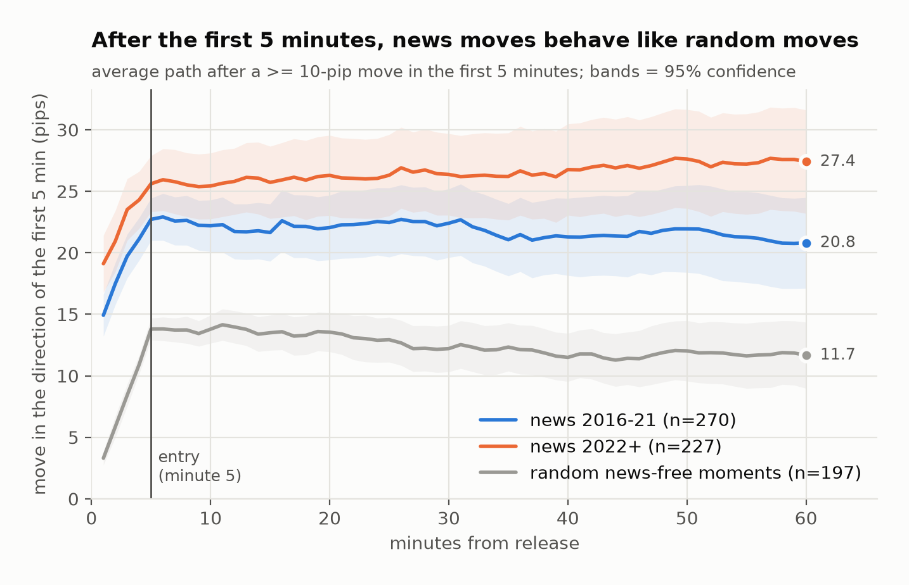

# EUR/USD after economic news

Can a retail trader profit by trading EUR/USD in the first hour after major US and euro-area
releases? This repo builds a clean, timestamp-verified dataset (2010–2025) and tests the idea
with real bid/ask costs, random control moments, out-of-sample periods and pre-registered
hypotheses.

**Result: no tradable edge.** After the first few minutes, a news move behaves like a random
move of the same size. Rules that work in 2016–21 reverse in 2022–25. The one historical
effect (big moves continuing) has decayed to zero.

**→ Full write-up: [REPORT.md](REPORT.md)**



## Quick start

```bash
uv run eurusd-news all      # calendar -> prices -> events -> qa   (first run downloads ~2.6 GB)
uv run eurusd-news baseline | regimes | expectations | ratecycle | figures
uv run pytest
```

Main dataset: `data/processed/events.parquet`, one row per release.

## What's in the repo

| Path | Purpose |
|---|---|
| `src/eurusd_news/catalog.py` | 25 indicators: names, issuer timezone, release-time changes over the years |
| `calendar.py` | Download and clean the calendar: time recovery, timezone fix, surprise z-scores (no look-ahead) |
| `prices.py` | Dukascopy ticks → 1-min bid/ask bars; HistData 2010–15 with the clock fix |
| `align.py` | Event table: price reaction at 1–240 min, spread, volatility before, time check against the price spike |
| `qa.py` | Clock cross-check between the price sources, data summary |
| `baseline.py` | Module 2: trade simulator, 324-rule grid, news-free control moments |
| `regimes.py`, `expectations.py`, `ratecycle.py` | Modules 2b–2d: pre-registered filter tests |
| `figures.py` | Charts in `reports/figures/` |
| `tests/` | 27 tests: alignment, clock fix, no look-ahead, simulator edge cases |

## Data sources

All pinned to exact Hugging Face commits in `config.py`.

| What | Source | Notes |
|---|---|---|
| Calendar (actual / forecast / previous) | `Ehsanrs2/Forex_Factory_Calendar` | ForexFactory scrape, 2007 → 2025-04-07. Third-party content: private research only, not redistributed here. |
| Prices 2016+ | `mito0o852/dukascopy-ticks` | ticks with real bid **and** ask |
| Prices 2010–2015 | `elthariel/histdata_fx_1m` | 1-minute bars, **bid only** |

## Known data problems and how they are handled

1. **Lost release times.** About 45% of calendar rows say 00:00. Fill order: the row's own FF
   time, then the time of a sibling release, then the official schedule. The column
   `time_source` records which was used.
2. **Wrong timezone offsets (2023+).** The scraper used outdated Iranian DST rules. The
   wall-clock is re-localized with current rules.
3. **Impact labels drift over time.** Events are selected by (currency, name), never by
   ForexFactory's impact label.
4. **The HistData clock is 60 minutes late in summer.** It follows the US DST calendar up to
   2018 and the EU one from 2019. Fixed in `prices.fix_histdata_clock`, and re-verified
   against Dukascopy by `eurusd-news qa`.
5. **Every time is checked against price.** `time_check` is `ok`, `unclear` (small reaction)
   or `suspect`.

## Main columns of `events.parquet`

- `release_utc`, `time_source`, `time_check`, `peak_offset_min`
- `actual_v`, `forecast_v`, `surprise`, `surprise_z` (scaled by *earlier* surprises only)
- `cluster_id`, `n_in_cluster`, `is_primary`: releases in the same minute are one market event
- `p0`, `ret_{1,5,15,30,60,240}m_pips`, `hi_60m_pips`, `lo_60m_pips`
- `pre_vol_60m_pips`, `spread_pre_pips`, `spread_max_5m_pips` (spreads are NaN before 2016)
