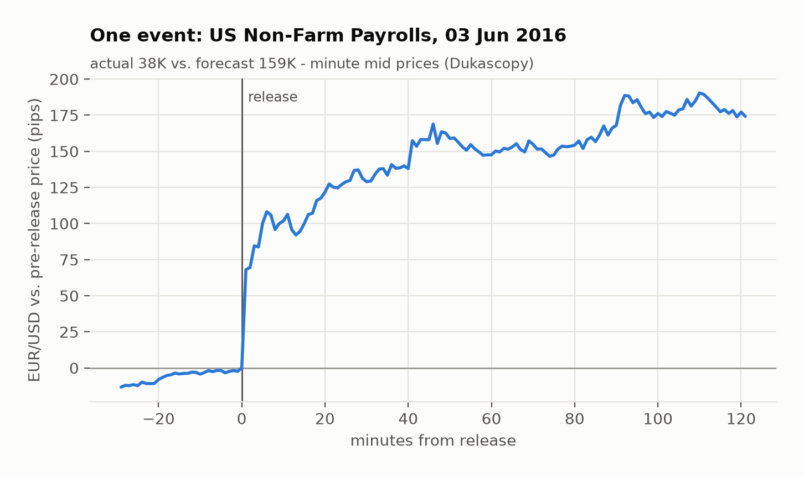
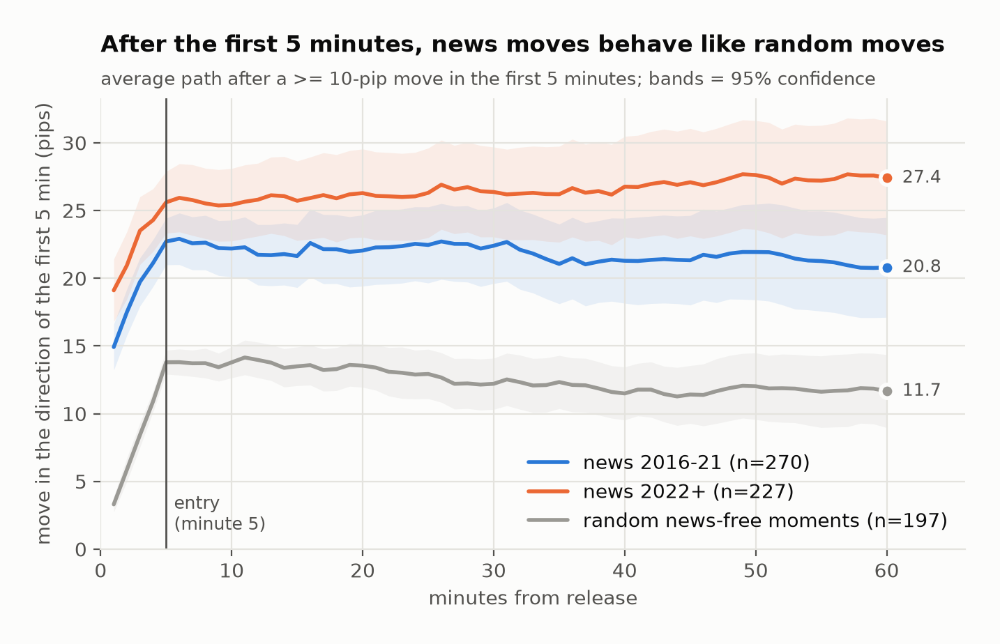
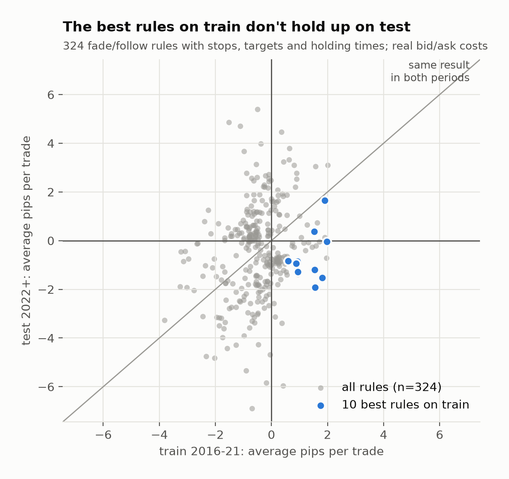
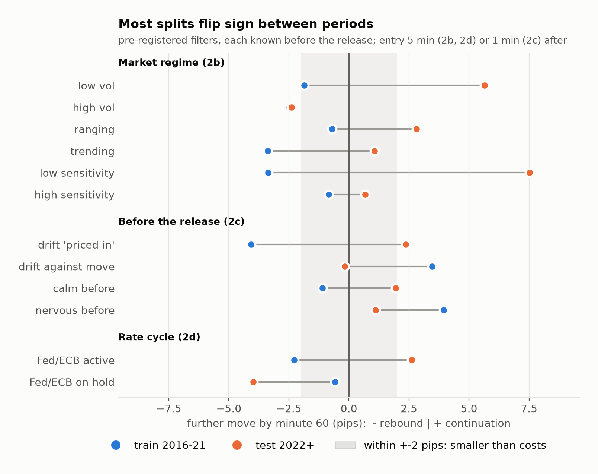
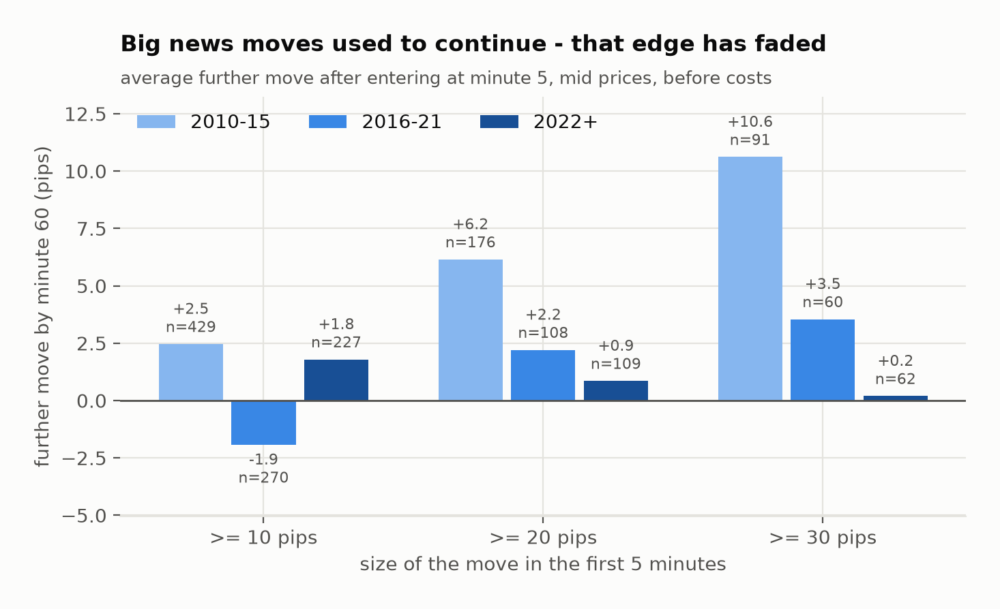

# Trading EUR/USD after economic news: a negative result

**Research report · November 2026 · data January 2010 – April 2025**

## Summary

I tested whether a retail trader can profit by trading EUR/USD in the first hour after major
US and euro-area economic releases. The planned instrument was a knock-out turbo on Trade
Republic, with a fixed stop, target and time limit.

- **Data.** I built a clean, timestamp-verified table of **4,009 releases** (25 indicators,
  2010–2025), aligned to **5.6 million one-minute EUR/USD bars**, with real bid/ask spreads
  from 2016 onward. Fixing the data took most of the work: lost release times, a timezone bug
  in the calendar source, and a seasonal one-hour clock error in the 2010–15 price source.
- **Testing.** I ran a 324-rule backtest with real costs, then four pre-registered tests of
  filters a trader would actually use: volatility and trend regime, pre-release positioning,
  the size of the move, and the central-bank cycle.
- **Result.** Nothing survives. After the first few minutes, a news move behaves no
  differently from a random move of the same size. Rules that work in 2016–21 reverse in
  2022–25. The one robust historical pattern, big moves continuing, made about +10 pips in
  2010–15 and is about 0 today.
- **Conclusion.** Don't trade this strategy. Building a machine-learning model on top was
  planned and deliberately cancelled: a model would only fit patterns that already fail out of
  sample.



---

## 1. Question and success criterion

> After a scheduled release, does EUR/USD **rebound** (or **continue**) often and far enough
> that a trade with a fixed stop, target and time limit has positive expected value after costs?

EV = P(target first) × target − P(stop first) × stop − costs.

The bar was set before any results were seen. A pattern counts only if it:
- **has the same sign in both periods:** train 2016–21 and test 2022 – Apr 2025;
- **is statistically significant:** |t| > 2;
- **is large enough to trade:** more than 2 pips per trade, since anything smaller is eaten by
  turbo spreads.

## 2. Data

| | Source | Coverage | Note |
|---|---|---|---|
| Release calendar (actual, forecast, previous) | ForexFactory history, Hugging Face scrape | 2010 – 2025-04-07 | 25 high-impact indicators; selected by name, not by FF's impact label, which drifts over time |
| Prices 2016+ | Dukascopy ticks → 1-min bars | 3.45 M bars | real bid **and** ask |
| Prices 2010–15 | HistData 1-min bars | 2.19 M bars | bid only, so no costs before 2016 |

Indicators:
- **US:** NFP, unemployment, earnings, CPI (headline and core), core PCE, advance GDP, retail
  sales, ISM manufacturing and services, the Fed rate decision.
- **Euro area:** the ECB decision and press conference, CPI flash, GDP flash, German and
  euro-area flash PMIs, Ifo, ZEW.

Releases in the same minute are merged into one market event: 4,009 releases form 2,499 events.

### Data problems found and fixed

Each fix has a unit test.

| Problem | Effect if ignored | Fix |
|---|---|---|
| 45% of calendar rows lost their time (show 00:00) | Event lands at midnight; reaction never seen | Take the time from a sibling release in the same group (e.g. NFP ← earnings), else from the official schedule per issuer timezone. Release-time changes are encoded: ECB 13:45 → 14:15 in 2022, FOMC 14:15 → 14:00 in 2013 |
| Scraper used outdated Iranian DST rules (Iran dropped DST in 2022) | Every 2023+ time off by an hour for half the year | Re-localize the wall-clock with current tz rules |
| HistData clock 60 min late in summer, following the **US** DST calendar until 2018 and the **EU** one from 2019 | 2010–15 reactions measured an hour early | Found by cross-correlating with Dukascopy in the weeks when US and EU clocks disagree. After the fix, the best lag is 0 in every check period |
| Wrong times in the source itself (e.g. core PCE on a Sunday) | Silent bad rows | Every release time is checked against the price spike: 1,221 **ok**, 1,202 **unclear** (small reaction), 74 **suspect**, mostly ECB press conferences |

## 3. Method

- **Real execution.** Buy at the ask, sell at the bid. If a minute bar touches both stop and
  target, the stop counts first. Stops that gap fill at the bar's open.
- **Control group.** For every release, 15 random *news-free* moments at the same time of day.
  This answers the key question: is the move special *because it is news*?
- **Out of sample.** Rules are chosen on 2016–21 and judged on 2022–25. 2010–15 serves as an
  extra untouched check (without costs).
- **No look-ahead.** Every filter uses only information available before the release:
  - surprise size is scaled by *earlier* surprises only;
  - regimes use the previous day's close;
  - positioning uses prices before the release.

  Tests verify that changing a future value never changes a past feature.
- **Pre-registration.** For Modules 2b–2d, the hypothesis, groups and pass rule are written at
  the top of the code file *before* the first run, and not changed afterwards.

## 4. Results

### 4.1 After the first minutes, news is just another move



The chart follows moves of at least 10 pips in the first 5 minutes. Most of the reaction is
over by minute 5. From there to minute 60:
- news moves give back 1.9 pips in 2016–21 and add 1.8 pips in 2022+;
- random news-free moves give back 2.1 pips.

A trader entering at minute 5 is no better off for having waited for news.

### 4.2 A rule grid overfits (Module 2)



The grid covered 324 combinations:
- fade or follow;
- entry after 1 or 5 minutes;
- move thresholds of 5, 10 or 20 pips;
- targets and stops of 10, 20 or 30 pips;
- holding times of 30, 120 or 240 minutes.

The train and test results are almost uncorrelated. The best rule on train (+1.8 pips, t = 1.7)
loses −1.5 on test. Of the 10 best, 8 lose money on test.

### 4.3 Pre-registered filters all fail (Modules 2b, 2c, 2d)



| Filter (known before the trade) | 2016–21 | 2022+ | Verdict |
|---|---|---|---|
| Low / high 20-day volatility | −1.9 / −2.5 | +5.7 / −2.4 | fail (high vol consistent, but t = −0.9) |
| Ranging / trending (efficiency ratio) | −0.7 / −3.4 | +2.8 / +1.1 | fail |
| Low / high indicator sensitivity | −3.4 / −0.8 | +7.5 / +0.7 | fail |
| Pre-release drift "priced in" / against | −4.1 / +3.5 | +2.4 / −0.2 | fail, sign flip |
| Calm / nervous before release | −1.1 / +3.9 | +1.9 / +1.1 | fail |
| Fed/ECB active / on hold | −2.3 / −0.6 | +2.6 / −4.0 | fail, opposite to the prediction in 2010–15 too |

All values are pips by minute 60; + means continuation. For "high vol" the two dots overlap
in the chart (−2.5 and −2.4).

The typical pattern: **rebound in 2016–21, continuation in 2022+**. No filter known in advance
predicts which of the two will happen, so the effects cancel. The rate-cycle test was designed
specifically to explain the 2022 change and fails in both directions.

### 4.4 Big moves: an edge that existed and faded (exploratory)



Moves of 30+ pips used to keep going (+10.6 pips in 2010–15), but the effect has shrunk to
+0.2 since 2022. This matches an edge being competed away by faster participants.

This part was *not* pre-registered: 24 cells were viewed after the fact, so it is shown as
context, not as evidence. Part of the 2010–15 number was never capturable, because spreads at
news times were wide and that period has no ask data.

### 4.5 Following instead of fading

85% of "follow" rules made money in 2022+, but following *random* moves of the same size made
more (+3 to +17 pips). 2022 was a strongly trending year for EUR/USD; the profit came from the
trend, not the news. Only 2 of 162 follow rules beat random moves in both periods, which is
about what luck alone produces.

## 5. Interpretation

EUR/USD is the most liquid market in the world, and these are the most-watched releases in it.
Algorithmic traders reprice within seconds. By the time a retail order lands (≥ 60 s), the
information is in the price. What is left is ordinary market noise, plus whatever the trend of
the year happens to be. The decay in 4.4 shows the same thing over time.

## 6. Limitations

- **Costs are understated.** Dukascopy's interbank spread (0.4 pips median at entry) is far
  below a turbo's spread at news time. Turbo financing and knock-out risk are not modelled.
  Real results would be *worse*, which only strengthens the conclusion.
- **1-minute resolution.** Second-level entries (tick data exists but was not used) could
  catch more of the initial move, but a retail turbo can't execute reliably at that speed.
- **Calendar quality.** The data is third-party scraped, and 45% of release times were
  reconstructed. The price-spike check confirms the timing where the market reacted, but
  forecast values cannot be independently verified.
- **Scope.** The study covers only high-impact US and euro-area releases, EUR/USD, and the
  first one to four hours. It says nothing about other markets, smaller releases, or
  multi-day effects.
- **Multiple testing.** About 25 pre-registered groups plus one exploratory grid were tested.
  One or two false passes would be expected by chance, so a single future "pass" would need
  fresh confirmation.

## 7. What would change the conclusion

- A **forward paper-trading log**: one rule fixed now, about 100 trades on new releases, judged
  once at the end.
- Different questions:
  - **longer horizons** (the day or week after a release);
  - **volatility rather than direction**, for example options;
  - **less efficient markets** reacting to the same news.

## Reproducing

```bash
uv run eurusd-news all          # download (~2.6 GB, pinned HF revisions) -> clean -> align -> QA
uv run eurusd-news baseline     # Module 2  rule grid + controls
uv run eurusd-news regimes      # Module 2b
uv run eurusd-news expectations # Module 2c
uv run eurusd-news ratecycle    # Module 2d
uv run eurusd-news figures      # charts in reports/figures/
uv run pytest                   # 27 tests (alignment, clock fix, no look-ahead, simulator)
```

Each module's pre-registered rules are in the docstring at the top of
`src/eurusd_news/{regimes,expectations,ratecycle}.py`. The ForexFactory data is third-party
content used for private research and is not included in the repository.
